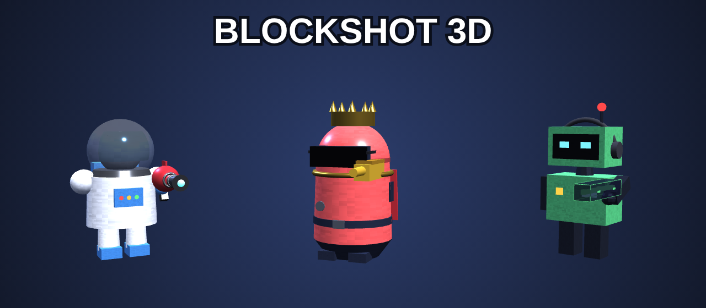

  

<b>Arena duels with upgrade cards.</b> Lose a round, pick a card. First to the target score wins.

Once installed, the game checks this page when it starts and grabs updates by itself. When one is ready, the title screen shows **Restart to update**.

---

For the curious: `app/` holds the game files and `update/manifest.json` lists each file's SHA-256. The game downloads only the files that changed (`electron/updater.cjs`). New versions are published with `node tools/publish-update.cjs <resources/app> <this repo>`.
